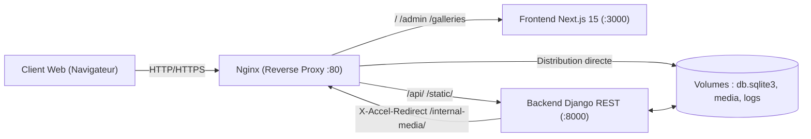

# 📖 Guide d'Exploitation & Déploiement : Still24 Portfolio

Ce guide détaille la mise en service, l'exploitation quotidienne, les procédures de mise à jour ciblée ou globale, ainsi que les bonnes pratiques de sauvegarde pour le portfolio **Still24**.

---

## 🏗️ 1. Architecture de la Stack

L'application repose sur une architecture 3-tiers conteneurisée :



- **Reverse Proxy Nginx :** Point d'entrée unique. Gère les certificats SSL, le rate-limiting anti-bruteforce (`zone=login_limit`), le routage vers Next.js et Django, et sert les fichiers médias protégés à haute vitesse via `X-Accel-Redirect`.
- **Frontend Next.js 15 :** Interface utilisateur en App Router avec rendu hybride. Protégé côté serveur par [`middleware.js`](file:///home/emilz/Documents/Perso/portfolio/middleware.js) qui valide les cookies `HttpOnly`.
- **Backend Django (Gunicorn) :** API REST sécurisée, modèle utilisateur UUID ([`CustomUser`](file:///home/emilz/Documents/Perso/portfolio/backend/users/models.py)), gestion des droits d'accès aux galeries privées ([`AccessGroup`](file:///home/emilz/Documents/Perso/portfolio/backend/galleries/models.py)).

---

## 🚀 2. Premier Lancement (Initialisation de Zéro)

À exécuter lors de la première installation sur le serveur (ou après une réinstallation complète).

### Étape 2.1 : Préparer les Fichiers d'Environnement

Créez le fichier `.env` à la racine du projet (s'il n'existe pas déjà) :

```bash
cp .env.example .env 2>/dev/null || cat << 'EOF' > .env
# Configuration Django
DJANGO_SECRET_KEY=cle_secrete_longue_et_aleatoire_a_generer_ici
BACKEND_ALLOWED_HOSTS=localhost,127.0.0.1,still24.fr,api.still24.fr
CORS_ALLOWED_ORIGINS=http://localhost:3000,https://still24.fr

# URLs Publiques Next.js
NEXT_PUBLIC_API_URL=https://still24.fr
NEXT_PUBLIC_MEDIA_URL=https://still24.fr/media

# Notifications de Sécurité (Ntfy)
NTFY_ENABLED=True
NTFY_SERVER_URL=https://ntfy.sh
NTFY_TOPIC_SUCCESS=still24-login-success
NTFY_TOPIC_FAILED=still24-login-failed
EOF
```

> [!TIP]
> Pour générer une clé secrète Django aléatoire et robuste en ligne de commande :
> ```bash
> python3 -c "import secrets; print(secrets.token_urlsafe(50))"
> ```

### Étape 2.2 : Préparer les Répertoires et Permissions

Créez les dossiers hôtes nécessaires pour les volumes persistants et les logs Wazuh/monitoring :

```bash
# Créer les dossiers de stockage et de logs
mkdir -p logs/nginx logs/backend
mkdir -p backend/media/galleries/images
mkdir -p backend/staticfiles

# Assurer les droits d'écriture
chmod -R 755 logs
chmod -R 775 backend/media
```

### Étape 2.3 : Construire et Lancer la Stack Docker

```bash
# 1. Construction des images (Next.js & Django)
docker compose build

# 2. Lancement en arrière-plan
docker compose up -d
```

### Étape 2.4 : Vérifier l'État des Services

Vérifiez que les trois conteneurs sont au statut `Up` (et `healthy` pour le backend) :

```bash
docker compose ps
```

Affichage attendu :
```
NAME                 STATUS                    PORTS
portfolio-backend    Up (healthy)              8000/tcp
portfolio-frontend   Up                        3000/tcp
portfolio-nginx      Up                        0.0.0.0:80->80/tcp
```

### Étape 2.5 : Créer l'Administrateur Initial & les Galeries par Défaut

Une fois les conteneurs démarrés, initialisez le compte d'administration principal et les galeries système :

```bash
# 1. Création de votre compte superadministrateur
docker compose exec backend python manage.py create_admin \
  --username emilien \
  --email "admin@still24.fr" \
  --password "VotreMotDePasseTresSecurise123"

# 2. Création des galeries par défaut (dont la galerie Best-Of)
docker compose exec backend python manage.py create_default_galleries
```

🎉 **Félicitations !** Votre site est maintenant 100% opérationnel :
- Site public : `http://localhost` (ou `https://still24.fr`)
- Espace administration : `http://localhost/admin`

---

## 🔄 3. Exploitation Quotidienne (Lancements Suivants)

Une fois initialisé, le projet se gère avec des commandes simples et idempotentes.

### Démarrage & Arrêt

```bash
# Démarrer tous les services en tâche de fond
docker compose up -d

# Arrêter les services proprement (en préservant les données)
docker compose stop

# Redémarrer l'ensemble de la stack
docker compose restart

# Arrêter et supprimer les conteneurs (les volumes et la base sont préservés)
docker compose down
```

### Surveillance des Logs en Temps Réel

```bash
# Tous les logs combinés
docker compose logs -f

# Logs spécifiques du backend Django (tentatives de connexion, auth Wazuh)
docker compose logs -f backend

# Logs spécifiques de Nginx (requêtes HTTP, X-Accel-Redirect)
docker compose logs -f nginx

# Logs spécifiques du frontend Next.js
docker compose logs -f frontend
```

### Lancement en Mode Développement Local (Sans Docker)

Si vous souhaitez coder en direct sur votre machine :

1. **Terminal 1 - Backend Django :**
   ```bash
   cd backend
   source venv/bin/activate
   python manage.py runserver 8000
   ```

2. **Terminal 2 - Frontend Next.js :**
   ```bash
   # À la racine du projet
   npm run dev
   ```
   *(Next.js proxifie automatiquement `/api/*` vers `http://127.0.0.1:8000` grâce au bloc `rewrites` dans `next.config.mjs`)*.

---

## 🛠️ 4. Procédures de Mise à Jour

Selon l'ampleur de vos modifications, plusieurs méthodes permettent d'appliquer les mises à jour sans interrompre inutilement les services.

### Option A : Mise à Jour Ciblée du Frontend (React / Next.js)

À utiliser lors d'ajouts de composants, modifications CSS ou refonte de pages :

```bash
# 1. Reconstruire uniquement l'image frontend
docker compose build frontend

# 2. Recréer le conteneur frontend à chaud (temps d'arrêt < 2 secondes)
docker compose up -d --no-deps frontend
```

### Option B : Mise à Jour Ciblée du Backend (Django / API)

À utiliser lors de modifications des vues, des modèles ou des règles de sécurité :

```bash
# 1. Reconstruire l'image backend
docker compose build backend

# 2. Redémarrer le backend (les migrations s'exécutent automatiquement via entrypoint.sh)
docker compose up -d --no-deps backend

# 3. Vérifier les logs pour confirmer l'application des migrations
docker compose logs backend --tail 30
```

### Option C : Mise à Jour Complète du Site (Déploiement Global)

À utiliser après un `git pull` avec modifications combinées frontend et backend :

```bash
# 1. Sauvegarder impérativement la base avant mise à jour majeure
cp backend/db.sqlite3 "backend/db.sqlite3.backup_$(date +%Y%m%d_%H%M%S)"

# 2. Reconstruire toutes les images sans cache
docker compose build --no-cache

# 3. Relancer la stack complète
docker compose up -d

# 4. Nettoyer les anciennes images orphelines pour libérer de l'espace disque
docker image prune -f
```

---

## 📦 5. Mise à Jour des Dépendances

### Mettre à Jour les Packages Backend (Python)

1. Mettez à jour le fichier [`backend/requirements.txt`](file:///home/emilz/Documents/Perso/portfolio/backend/requirements.txt).
2. Lancez le rebuild du backend :
   ```bash
   docker compose build --no-cache backend
   docker compose up -d backend
   ```

### Mettre à Jour les Packages Frontend (Node / npm)

1. Mettez à jour [`package.json`](file:///home/emilz/Documents/Perso/portfolio/package.json) ou lancez :
   ```bash
   corepack npm install <package>@latest
   ```
2. Reconstruisez le conteneur frontend :
   ```bash
   docker compose build --no-cache frontend
   docker compose up -d frontend
   ```

---

## 💾 6. Stratégie de Sauvegarde & Restauration

### Sauvegarde Complète (Recommandé avant toute mise en production)

Exécutez ce script de sauvegarde rapide :

```bash
BACKUP_DIR="backups/$(date +%Y%m%d_%H%M%S)"
mkdir -p "$BACKUP_DIR"

# 1. Sauvegarde de la base de données SQLite
docker compose exec -T backend python manage.py dumpdata > "$BACKUP_DIR/db_dump.json"
cp backend/db.sqlite3 "$BACKUP_DIR/db.sqlite3"

# 2. Sauvegarde des photos et médias
tar -czf "$BACKUP_DIR/media_backup.tar.gz" backend/media/

# 3. Sauvegarde de la configuration
cp .env "$BACKUP_DIR/.env"
cp docker-compose.yml "$BACKUP_DIR/docker-compose.yml"

echo "✅ Sauvegarde terminée avec succès dans : $BACKUP_DIR"
```

### Procédure de Restauration (Rollback en Cas de Problème)

```bash
# 1. Arrêter la stack
docker compose down

# 2. Restaurer la base SQLite et les médias
cp backups/DATE_DU_BACKUP/db.sqlite3 backend/db.sqlite3
tar -xzf backups/DATE_DU_BACKUP/media_backup.tar.gz -C .

# 3. Relancer les conteneurs
docker compose up -d
```

---

## 📋 7. Aide-Mémoire des Commandes Utiles

| Action | Commande |
| :--- | :--- |
| **Créer / Réinitialiser un admin** | `docker compose exec backend python manage.py create_admin --username <nom> --password "<mdp>"` |
| **Créer les galeries par défaut** | `docker compose exec backend python manage.py create_default_galleries` |
| **Exécuter les tests de sécurité** | `docker compose exec backend python manage.py test users galleries` |
| **Accéder au shell Django** | `docker compose exec backend python manage.py shell` |
| **Inspecter le conteneur en bash** | `docker compose exec backend /bin/bash` |
| **Recharger Nginx sans coupure** | `docker compose exec nginx nginx -s reload` |
| **Vérifier l'espace disque Docker** | `docker system df` |
